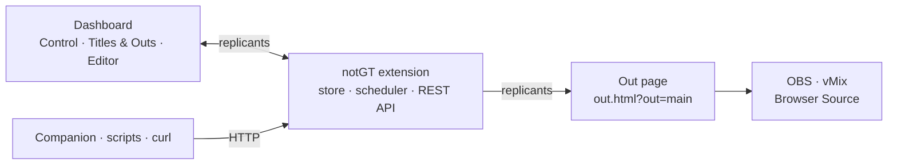

<h1 align="center">
  <picture>
    <source media="(prefers-color-scheme: dark)" srcset="media/brand/notgt-logo-on-dark.svg">
    
  </picture>
</h1>

<p align="center">
  <b>Titles without the extra magic.</b><br>
  Broadcast titles and animated graphics made with web technologies —<br>
  an open alternative to vMix GT, built on NodeCG.
</p>

<p align="center"><b>English</b> · <a href="README_RU.md">Русский</a></p>

<p align="center">
  
  
  
  
  
  
</p>

<p align="center">
  <video src="media/present.mp4" poster="media/present.jpg" controls width="900"></video>
</p>

<p align="center">
  <a href="https://github.com/user-attachments/assets/52d9aae9-f9ee-41ef-9719-8a67913fda9d"><b>▶ Watch notGT in 22 seconds</b></a> — the dashboard, the out and the editor, filmed from a running server
</p>

<p align="center">
  
</p>

## What notGT is

notGT is a titling system for live production. You draw a title in the browser — from
layers, or as plain HTML, CSS and JavaScript — put it on an **out**, and add that out to
OBS, vMix or anything else that can show a web page. From then on the title is driven
from the dashboard, from a Bitfocus Companion button or from one HTTP request.

The name says what it is for: **GT is struck through, so it is replaced.** notGT does the
job of a title designer and its player without a Windows-only editor, without a licence
and without a file format of its own: a title is a web page, and everything the web can
do, a title can do.

It began as a fork of [NodeCG](https://nodecg.dev/) and still stands on it — the server,
the replicants and the bundle API are NodeCG's. But it is an application, not a
framework: it has its own dashboard, its own editor and its own renderer, and it is
ready to use the moment it starts.

## What it does

- **A visual editor.** The canvas is the out itself. Text, shapes, images, GIFs and
  video with alpha are layers you drag, scale and crop, with magnets to the centre, the
  edges, the safe area and each other.
- **Titles in code.** An animation can be HTML, CSS and JavaScript with a small runtime
  (`vars`, `onData`, `onShow`, `onHide`) and a live preview next to the code. It can also
  be a file in a folder, if you would rather write it in your own editor.
- **Variables, not retyping.** Names, scores and captions live in one data store. Change
  a value and it changes on air without replaying the entrance; pick a row of a list and
  that guest goes on air.
- **As many outs as you need.** Each out is one transparent page at its own size, and one
  Browser Source. What is on air on which out is always in sight, in Lemon yellow.
- **Timed or held.** A title plays once and leaves by itself, or stays until it is
  switched off. The timers run on the server, so every out and every dashboard agree.
- **REST API.** Show, hide, toggle and trigger titles, write variables, manage outs and
  the library — from Companion, a script or `curl`.
- **WebSocket API.** The same verbs on `/api/ws`, with the state pushed when it changes —
  what a Companion module connects to, no polling.
- **Sign-in.** The dashboard asks for a username and a password — `admin` / `admin` on a
  new server, to be changed on the first day — and the API is not open to the whole
  network. It can be switched off for a closed show LAN.
- **Team.** An administrator adds users and puts them in groups — VJ, streamer 1,
  streamer 2. A group has its outs and its own WebSocket keys; every out has one OBS link
  that belongs to no one and opens that out only.
- **Alpha video.** Drop a ProRes or HEVC clip with transparency onto the editor and it
  is converted with ffmpeg to something a browser can play.
- **Excel as data.** Drop a workbook on the Data panel, or track one on the server: each
  sheet becomes a list, the file is re-read when it is saved, and an edit in the
  dashboard is written back into it.
- **A library to start from.** Eleven ready-made titles in one style: lower thirds, a
  score bug, a live poll, a ticker, a countdown, a clock, a weather card and more.
- **Yours to read.** The interface is in English and Russian, in a dark and a light
  theme.

<table>
  <tr>
    <td width="50%"></td>
    <td width="50%"></td>
  </tr>
  <tr>
    <td align="center"><b>Control</b> — what is on air, and the data behind it</td>
    <td align="center"><b>Editor</b> — the out as a canvas, with what is on air shown live</td>
  </tr>
  <tr>
    <td colspan="2"></td>
  </tr>
  <tr>
    <td colspan="2" align="center">The same Editor in the light theme. The stage stays dark: a title is drawn for video.</td>
  </tr>
</table>

## Quick start

### Docker

```bash
git clone https://github.com/fursyt12/notGT.git
cd notGT
docker compose up --build -d      # http://localhost:9090/dashboard/
```

Sign in as **`admin` / `admin`** and change the password in the **Team** tab straight
away. No reverse proxy and no `.env` are needed. Set `NOTGT_PORT` in a `.env` (copy
`.env.example`) to publish another port, `NOTGT_LOGIN=off` to switch the sign-in off, and
see the commented-out TRAEFIK block in `docker-compose.yml` for a hostname and TLS in
front of it.

<details>
<summary>If the image does not build</summary>

The image installs dependencies three times (monorepo, bundle, production-only), so the
first build takes a few minutes and needs a couple of GB of scratch space. If it dies
inside an `npm ci` step, read the lines _above_ npm's `Exit handler never called!`: that
message is npm's crash tail, and the line above it is normally
`npm error network read ETIMEDOUT` — a registry read timed out mid-install, which the
Dockerfile already retries five times.

```bash
docker compose build --progress=plain 2>&1 | tail -60
```

If the registry is slow or filtered from your network, build against a mirror instead of
editing anything:

```bash
NPM_REGISTRY=https://registry.npmmirror.com docker compose build
```

In Docker Desktop a plain `npm ci` failure can also be the VM running out of memory or
disk (`docker system df` to check, Settings → Resources to raise the limit); the image
pins its npm version and wipes its own cache to keep layers small.

</details>

### Windows

Take the portable build from [Releases](https://github.com/fursyt12/notGT/releases),
unpack it and run `notGT Launcher.exe`. Nothing has to be installed: the package carries
its own Node.js. The launcher picks a network interface and a port, starts the server and
opens the dashboard.

To build the package yourself:

```powershell
node scripts/build-windows.mjs --node-version 22.14.0
```

It assembles `dist/notGT-win-x64/` and `dist/notGT-win-x64.zip`; state lives in
`app\cfg`, `app\db` and `app\assets`. Every push to `main` builds the package on
`windows-latest`, and a `v*` tag publishes it as a release. The layout, the flags and the
release process are in [`docs/windows-build.md`](docs/windows-build.md).

### From source

Node.js 22 is needed. The bundle is **not** an npm workspace of this monorepo, so it has
its own `node_modules` and is installed and built separately:

```bash
npm ci
npm run build
cd bundles/notGT && npm install && npm run build && cd ../..
node index.js      # http://localhost:9090/dashboard/
```

### Put it on air

Add a Browser Source to OBS (or a Web Browser input to vMix) at the size of the out:

```
http://<host>:9090/bundles/notGT/graphics/out.html?out=main
```

Then show a title — from the Control panel, or from anywhere else:

```bash
curl -X POST http://localhost:9090/api/titles/lower-third/show
curl -X POST 'http://localhost:9090/api/data?mode=merge' \
     -H 'content-type: application/json' \
     -d '{"speaker": {"name": "Anna Reed", "role": "Expert"}}'
curl -X POST http://localhost:9090/api/titles/hide
```

## How it works



- An **animation** is a template in the library: layers, or code.
- An **out** is a canvas of a fixed size with a URL. A **placement** puts an animation on
  an out at a position and a scale, with its own playback.
- **Variables** are the data the titles read. The out page keeps running while they
  change, so a correction never restarts anything.
- The **extension** holds the state, runs the timers and answers the API. The out page
  only draws what it is told to — which is why the Editor can show what is on air by
  embedding that very page.

## Stack

| Part              | Built with                                                                                   |
| ----------------- | -------------------------------------------------------------------------------------------- |
| Runtime           | Node.js 22 · NodeCG 2.8 (Express, Socket.IO, Effect) · SQLite for what must survive a restart |
| Dashboard panels  | React 18 · TypeScript · Konva for the editor canvas · plain CSS on design tokens             |
| Dashboard shell   | NodeCG's Polymer shell, restyled and reduced to the three panels                             |
| Out page          | TypeScript and the DOM, no framework · code animations in sandboxed iframes                  |
| Build             | Vite (panels and out page) · esbuild (extension) · tsdown (NodeCG core)                      |
| Media             | ffmpeg — alpha video to WebM and WebP                                                        |
| Data              | ExcelJS — `.xlsx` workbooks as list variables, read and written                              |
| Tests             | Puppeteer end-to-end suites for the out page and the panels · Vitest for the core            |
| Packaging         | Multi-stage Docker image · portable Windows build with a launcher · GitHub Actions           |
| Type              | Montserrat and Handjet, self-hosted (SIL Open Font License)                                  |

## Repository

```
bundles/notGT/          the application
  src/extension/        store, scheduler, REST API, media conversion
  src/dashboard/        Control, Titles & Outs, Editor
  src/graphics/         the out page and the runtime of code animations
  src/shared/           types, variable bindings, the example library
  graphics/animations/  animations written as files go here
  scripts/              build and end-to-end tests
workspaces/nodecg/      NodeCG core, with the notGT shell
workspaces/…            the rest of the NodeCG monorepo (CLI, database adapters)
launcher/               the control panel of the Windows build
media/brand/            logo, mark and the brandbook
docs/                   the Windows build, notes on the core
```

## Documentation

| | |
| --- | --- |
| **[Operator manual](bundles/notGT/README.md)** · [по-русски](bundles/notGT/README_RU.md) | The mental model, the panels, sign-in and the team, the full REST and WebSocket API, OBS and Companion setup, writing a code animation, alpha video, persistence, troubleshooting |
| **[Generating titles with an LLM](GENERATE_TITLES.md)** · [по-русски](GENERATE_TITLES_RU.md) | A prompt that already knows the runtime contract: fill in what you want, get `html` / `css` / `js` for a code animation |
| **[Windows build](docs/windows-build.md)** | The layout of the portable package, the build flags, the release process |
| **[Launcher](launcher/README.md)** | The small control panel that starts the server on Windows |
| **[NodeCG documentation](https://nodecg.dev/)** | The platform underneath: bundles, replicants, the extension API |

## Brand

<p>
  
  
  
  
  
</p>

Studio is the ground and Cream the type; Signal is the accent, Amber the second one, and
Lemon means LIVE and nothing else. Handjet sets the logo, headings and timecodes;
Montserrat sets everything that is read. The dashboard, the example library and this page
all follow the brandbook, and the logo files are in [`media/brand/`](media/brand/).

<p align="center">
  
</p>

## Development

```bash
# the application
cd bundles/notGT
npm install
npm run watch          # rebuild the extension, the panels and the out page on change
npm run typecheck
npm run test:e2e       # needs a running server; NOTGT_BASE=http://host:port to point at it

# the core
npm ci                 # from the repository root
npm run dev            # rebuild and type-check on change
npx vitest run
```

The dashboard's language file is `bundles/notGT/src/dashboard/locales/ru.json`; a phrase
without a translation is a type error. The colours of both themes are the tokens at the
top of `bundles/notGT/dashboard/ui.css`.

## notGT and NodeCG

notGT would not exist without [NodeCG](https://github.com/nodecg/nodecg), the broadcast
graphics framework by Alex “Lange” Van Camp, Matt “Bluee” McNamara, Keiichiro “Hoishin”
Amemiya and its contributors. This repository keeps the NodeCG monorepo whole, and the
upstream documentation still applies to everything below the application. What differs
is on top: the shell around the panels, and the `notGT` bundle that is the application
itself.

## Licence

[MIT](LICENSE), like NodeCG. The fonts are under the SIL Open Font License; their
licences travel with them in `bundles/notGT/graphics/fonts/`.
