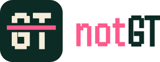
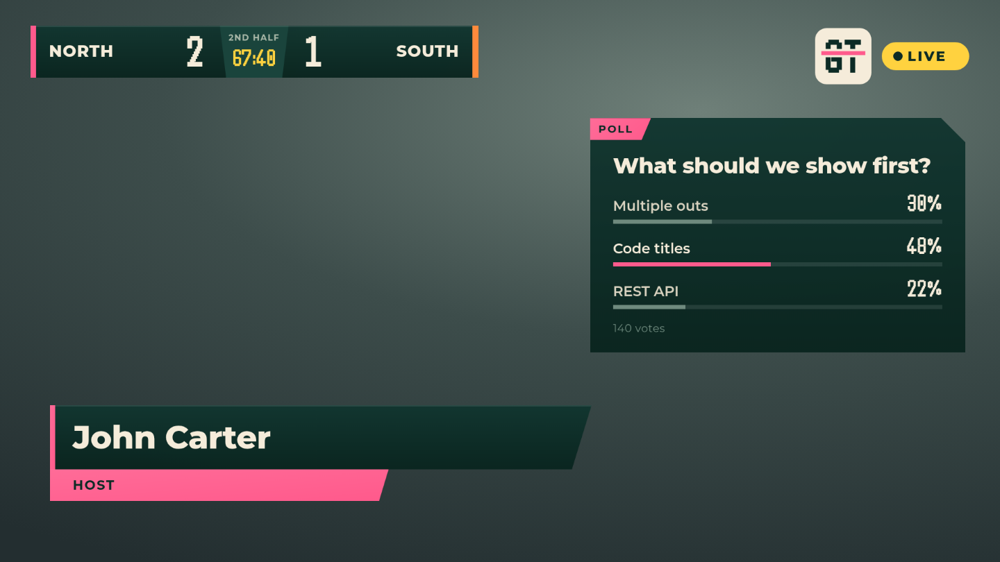
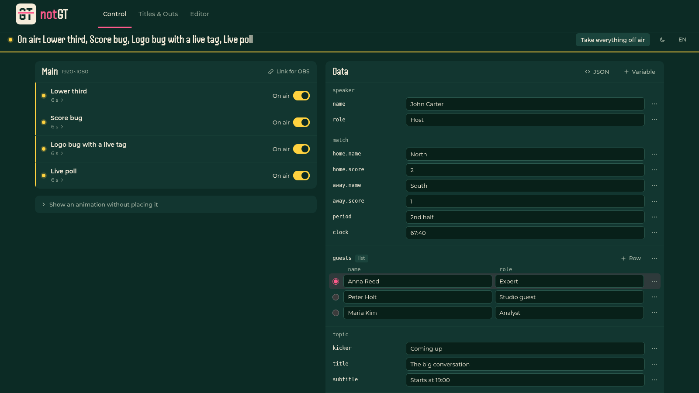
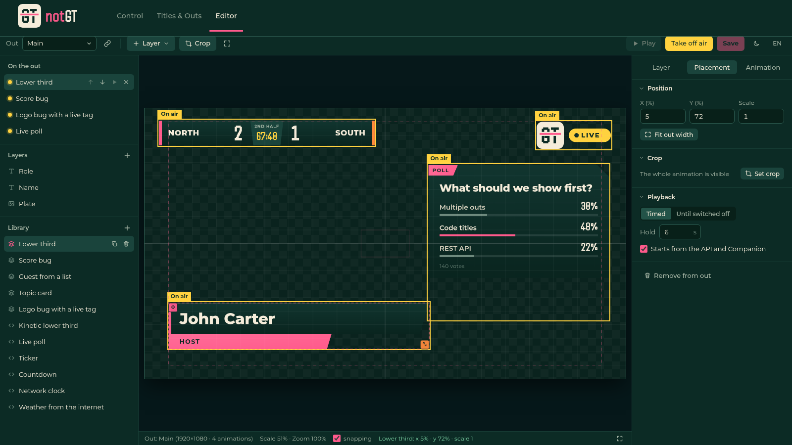
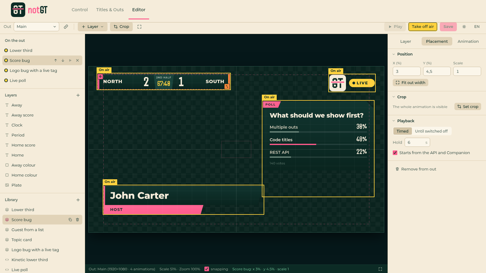
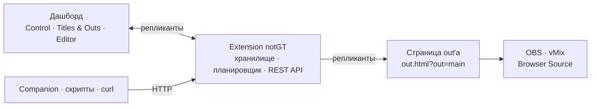
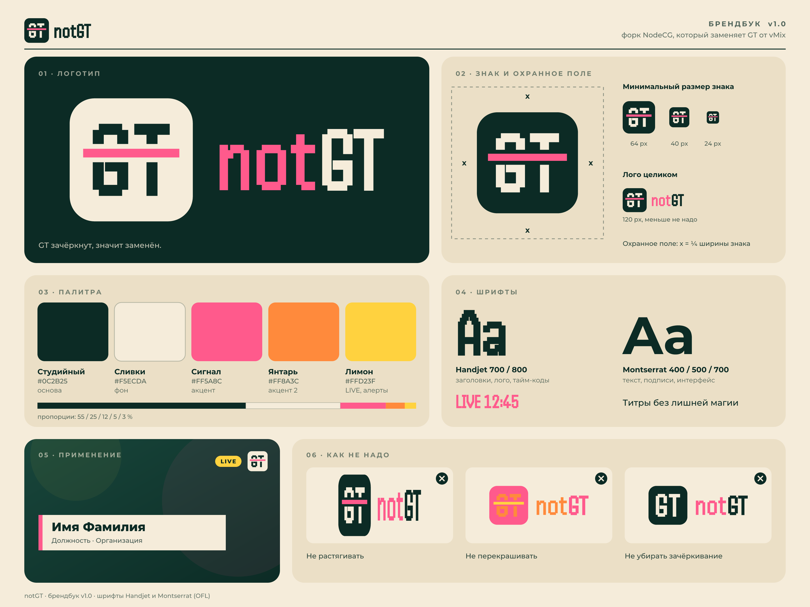

<h1 align="center">
  <picture>
    <source media="(prefers-color-scheme: dark)" srcset="media/brand/notgt-logo-on-dark.svg">
    
  </picture>
</h1>

<p align="center">
  <b>Титры без лишней магии.</b><br>
  Эфирные титры и анимированная графика на веб-технологиях —<br>
  открытая замена GT от vMix, построенная на NodeCG.
</p>

<p align="center"><a href="README.md">English</a> · <b>Русский</b></p>

<p align="center">
  
  
  
  
  
  
</p>

## Демо

https://github.com/user-attachments/assets/52d9aae9-f9ee-41ef-9719-8a67913fda9d

<p align="center">
  
</p>

## Что такое notGT

notGT — система титров для живого эфира. Титр рисуется в браузере — из слоёв или обычным
HTML, CSS и JavaScript, — ставится на **out**, а out добавляется в OBS, vMix или куда
угодно, где можно показать веб-страницу. Дальше титром управляют из дашборда, с кнопки
Bitfocus Companion или одним HTTP-запросом.

Название говорит, зачем он нужен: **GT зачёркнут, значит заменён.** notGT делает работу
редактора титров и их проигрывателя — без редактора только под Windows, без лицензии и
без собственного формата файлов: титр — это веб-страница, и всё, что умеет веб, умеет
титр.

Проект начался как форк [NodeCG](https://nodecg.dev/) и по-прежнему стоит на нём —
сервер, репликанты и API бандлов здесь от NodeCG. Но это приложение, а не фреймворк: у
него свой дашборд, свой редактор и свой рендерер, и работать с ним можно сразу после
запуска.

## Что он умеет

- **Визуальный редактор.** Холст — это сам out. Текст, фигуры, картинки, GIF и видео с
  альфой — слои, которые двигают, масштабируют и обрезают, с магнитами к центру, краям,
  безопасной зоне и друг к другу.
- **Титры кодом.** Анимация может быть написана на HTML, CSS и JavaScript с небольшим
  рантаймом (`vars`, `onData`, `onShow`, `onHide`) и живым превью рядом с кодом. Или
  лежать файлом в каталоге, если удобнее писать в своём редакторе.
- **Переменные вместо перепечатывания.** Имена, счёт и подписи живут в одном хранилище
  данных. Меняете значение — оно меняется в эфире, не проигрывая появление заново;
  выбираете строку списка — в эфир идёт этот гость.
- **Сколько угодно out'ов.** Каждый out — одна прозрачная страница своего размера и один
  Browser Source. Что и на каком out'е сейчас в эфире, всегда видно — жёлтым Lemon.
- **По времени или до выключения.** Титр проигрывается один раз и уходит сам либо стоит,
  пока его не выключат. Таймеры идут на сервере, поэтому все out'ы и все дашборды
  согласованы.
- **REST API.** Показать, убрать, переключить и проиграть титр, записать переменные,
  управлять out'ами и библиотекой — из Companion, скрипта или `curl`.
- **WebSocket API.** Те же действия на `/api/ws`, а состояние приходит само, когда
  меняется, — к нему подключается модуль Companion, без polling'а.
- **Выходы NDI.** Для Resolume Arena, vMix и всего, что принимает NDI, а не веб-страницу:
  включите NDI у out'а, и небольшой отправитель — на сервере или на Raspberry Pi — отдаст
  его в сеть с прозрачностью, в размер out'а или меньше. Он рисует только то, что
  движется, и ничего не отправляет, пока никто не смотрит. См. [ndi/](ndi/README_RU.md).
- **Вход по паролю.** Панель спрашивает имя и пароль — на новом сервере это `admin` /
  `admin`, их меняют в первый же день, — и API не открыт всей сети. Для закрытой сети
  площадки вход можно выключить.
- **Команда.** Администратор добавляет пользователей и распределяет их по группам — VJ,
  стример 1, стример 2. У группы свои out'ы и свои ключи WebSocket; у каждого out'а одна
  ссылка для OBS, которая не принадлежит никому и открывает только этот out.
- **Видео с альфой.** Бросьте в редактор ролик ProRes или HEVC с прозрачностью — он
  конвертируется через ffmpeg в то, что умеет проигрывать браузер.
- **Excel как данные.** Бросьте книгу на панель Data или следите за книгой на сервере:
  каждый лист становится списком, файл перечитывается при сохранении, а правка в
  дашборде записывается обратно в него.
- **Шоу одним файлом.** Все анимации, out'ы и переменные вместе с их медиа сохраняются
  в один файл `.ngt` — и открываются здесь или на другом сервере.
- **Библиотека для старта.** Одиннадцать готовых титров в одном стиле: плашки с именем,
  счёт матча, опрос, бегущая строка, обратный отсчёт, часы, карточка погоды и другие.
- **Читается как удобно.** Интерфейс на английском и русском, в тёмной и светлой теме.

<table>
  <tr>
    <td width="50%"></td>
    <td width="50%"></td>
  </tr>
  <tr>
    <td align="center"><b>Control</b> — что в эфире и данные, которые за этим стоят</td>
    <td align="center"><b>Editor</b> — out как холст; то, что в эфире, показано вживую</td>
  </tr>
  <tr>
    <td colspan="2"></td>
  </tr>
  <tr>
    <td colspan="2" align="center">Тот же Editor в светлой теме. Сцена остаётся тёмной: титр рисуется для видео.</td>
  </tr>
</table>

## Быстрый старт

### Docker

```bash
git clone https://github.com/fursyt12/notGT.git
cd notGT
docker compose up --build -d      # http://localhost:9090/dashboard/
```

Войдите как **`admin` / `admin`** и сразу смените пароль во вкладке **Команда**. Ни
обратный прокси, ни `.env` не нужны. Чтобы опубликовать другой порт, задайте `NOTGT_PORT`
в `.env` (скопируйте `.env.example`); чтобы выключить вход — `NOTGT_LOGIN=off`; если перед
сервисом нужны имя хоста и TLS — смотрите закомментированный блок TRAEFIK в
`docker-compose.yml`.

**NDI** для Resolume и подобных идёт в комплекте на Linux-хосте (и на Raspberry Pi):
впишите в `.env` `COMPOSE_PROFILES=ndi` и `NDI_ACCEPT_LICENSE=yes` (лицензия NDI SDK —
сборка скачивает библиотеку NDI), выполните тот же `docker compose up --build -d` и
включите NDI у out'а. См. [ndi/README_RU.md](ndi/README_RU.md#docker).

<details>
<summary>Если образ не собирается</summary>

Образ ставит зависимости трижды (монорепозиторий, бандл, только production), поэтому
первая сборка занимает несколько минут и требует пары гигабайт свободного места. Если
она падает на шаге `npm ci`, читайте строки _выше_ сообщения npm
`Exit handler never called!`: это хвост аварийного вывода npm, а строкой выше обычно
стоит `npm error network read ETIMEDOUT` — чтение из реестра оборвалось по таймауту
посреди установки. Dockerfile и так повторяет его пять раз.

```bash
docker compose build --progress=plain 2>&1 | tail -60
```

Если реестр из вашей сети медленный или фильтруется, собирайте через зеркало, ничего не
редактируя:

```bash
NPM_REGISTRY=https://registry.npmmirror.com docker compose build
```

В Docker Desktop обычный сбой `npm ci` может ещё означать, что у виртуальной машины
кончилась память или диск (проверить — `docker system df`, поднять лимит — Settings →
Resources); образ фиксирует версию npm и сам чистит свой кэш, чтобы слои оставались
маленькими.

</details>

### Windows

Возьмите портативную сборку в [Releases](https://github.com/fursyt12/notGT/releases),
распакуйте и запустите `notGT Launcher.exe`. Устанавливать ничего не нужно: Node.js идёт
в комплекте. Лаунчер выбирает сетевой интерфейс и порт, запускает сервер и открывает
дашборд.

Собрать пакет самому:

```powershell
node scripts/build-windows.mjs --node-version 22.14.0
```

Скрипт собирает `dist/notGT-win-x64/` и `dist/notGT-win-x64.zip`; состояние хранится в
`app\cfg`, `app\db` и `app\assets`. Каждый push в `main` собирает пакет на
`windows-latest`, а тег `v*` публикует его как релиз. Структура пакета, флаги и процесс
релиза — в [`docs/windows-build.md`](docs/windows-build.md).

### macOS

Такая же портативная сборка для Mac на процессорах Apple (M1 и новее) лежит в
[Releases](https://github.com/fursyt12/notGT/releases) как `notGT-macos-arm64.zip`:
распакуйте её и запустите `notGT Launcher` из распакованной папки. Это тот же лаунчер в
собственном окне, и Node.js тоже идёт в комплекте.

Сборка не подписана сертификатом разработчика Apple, поэтому первый запуск нужно
разрешить: «Системные настройки» → «Конфиденциальность и безопасность» → «Всё равно
открыть», либо `xattr -dr com.apple.quarantine <распакованная папка>` в Терминале. Как
собирается пакет — в [`docs/macos-build.md`](docs/macos-build.md).

### Из исходников

Нужен Node.js 22. Бандл **не** входит в npm workspace этого монорепозитория, поэтому у
него свои `node_modules`, а ставится и собирается он отдельно:

```bash
npm ci
npm run build
cd bundles/notGT && npm install && npm run build && cd ../..
node index.js      # http://localhost:9090/dashboard/
```

### В эфир

Добавьте в OBS Browser Source (или вход Web Browser в vMix) по размеру out'а:

```
http://<host>:9090/bundles/notGT/graphics/out.html?out=main
```

Для Resolume Arena и других программ, принимающих NDI, включите **NDI** у out'а в
**Titles & Outs** и запустите отправитель командой, которую покажет панель, — см.
[ndi/README_RU.md](ndi/README_RU.md).

И покажите титр — из панели Control или откуда угодно ещё:

```bash
curl -X POST http://localhost:9090/api/titles/lower-third/show
curl -X POST 'http://localhost:9090/api/data?mode=merge' \
     -H 'content-type: application/json' \
     -d '{"speaker": {"name": "Анна Смирнова", "role": "Эксперт"}}'
curl -X POST http://localhost:9090/api/titles/hide
```

## Как это устроено



- **Анимация** — шаблон в библиотеке: слои или код.
- **Out** — холст фиксированного размера со своим URL. **Размещение** ставит анимацию на
  out в нужной позиции и масштабе, со своим режимом показа.
- **Переменные** — данные, которые читают титры. Страница out'а продолжает работать,
  пока они меняются, поэтому правка ничего не перезапускает.
- **Extension** хранит состояние, ведёт таймеры и отвечает на запросы API. Страница
  out'а только рисует то, что ей сказано, — поэтому Editor и показывает эфир, просто
  встраивая эту самую страницу.

## Стек

| Часть             | На чём сделано                                                                                  |
| ----------------- | ----------------------------------------------------------------------------------------------- |
| Рантайм           | Node.js 22 · NodeCG 2.8 (Express, Socket.IO, Effect) · SQLite для того, что переживает рестарт  |
| Панели дашборда   | React 18 · TypeScript · Konva для холста редактора · обычный CSS на дизайн-токенах              |
| Оболочка дашборда | Polymer-оболочка NodeCG, перекрашенная и сведённая к трём панелям                               |
| Страница out'а    | TypeScript и DOM, без фреймворка · код-анимации в изолированных iframe                          |
| Сборка            | Vite (панели и страница out'а) · esbuild (extension) · tsdown (ядро NodeCG)                     |
| Медиа             | ffmpeg — видео с альфой в WebM и WebP                                                           |
| Данные            | ExcelJS — книги `.xlsx` как переменные-списки, чтение и запись                                  |
| Тесты             | Сквозные тесты на Puppeteer для страницы out'а и панелей · Vitest для ядра                      |
| Поставка          | Многоэтапный Docker-образ · портативные сборки под Windows и macOS с лаунчером · GitHub Actions |
| Шрифты            | Montserrat и Handjet, лежат в репозитории (SIL Open Font License)                               |

## Репозиторий

```
bundles/notGT/          само приложение
  src/extension/        хранилище, планировщик, REST API, конвертация медиа
  src/dashboard/        Control, Titles & Outs, Editor
  src/graphics/         страница out'а и рантайм код-анимаций
  src/shared/           типы, привязки переменных, библиотека примеров
  graphics/animations/  сюда кладут анимации, написанные файлами
  scripts/              сборка и сквозные тесты
workspaces/nodecg/      ядро NodeCG с оболочкой notGT
workspaces/…            остальной монорепозиторий NodeCG (CLI, адаптеры БД)
launcher/               панель управления сборок под Windows и macOS
ndi/                    отправитель NDI: out'ы как источники NDI, для Resolume и подобных
media/brand/            логотип, знак и брендбук
docs/                   сборки под Windows и macOS, заметки о ядре
```

## Документация

| | |
| --- | --- |
| **[Руководство оператора](bundles/notGT/README_RU.md)** · [in English](bundles/notGT/README.md) | Ментальная модель, панели, вход по паролю и команда, полный справочник REST и WebSocket API, настройка OBS и Companion, как писать код-анимацию, видео с альфой, персистентность, траблшутинг |
| **[Генерация титров через LLM](GENERATE_TITLES_RU.md)** · [in English](GENERATE_TITLES.md) | Промпт, который уже знает контракт рантайма: опишите, что нужно, и получите `html` / `css` / `js` для код-анимации |
| **[Сборка под Windows](docs/windows-build.md)** | Структура портативного пакета, флаги сборки, процесс релиза |
| **[Сборка под macOS](docs/macos-build.md)** | Тот же пакет для Mac: его структура, окно лаунчера, почему первый запуск нужно разрешить |
| **[Лаунчер](launcher/README.md)** | Небольшая панель, которая запускает сервер под Windows и macOS |
| **[Документация NodeCG](https://nodecg.dev/)** | Платформа под приложением: бандлы, репликанты, API extension'ов |

## Бренд

<p>
  
  
  
  
  
</p>

Studio — основа, Cream — текст; Signal — акцент, Amber — второй акцент, а Lemon означает
LIVE и больше ничего. Шрифтом Handjet набраны логотип, заголовки и тайм-коды, шрифтом
Montserrat — всё, что читают. Дашборд, библиотека примеров и эта страница следуют
брендбуку, а файлы логотипа лежат в [`media/brand/`](media/brand/).

<p align="center">
  
</p>

## Разработка

```bash
# приложение
cd bundles/notGT
npm install
npm run watch          # пересборка extension, панелей и страницы out'а при изменениях
npm run typecheck
npm run test:e2e       # нужен запущенный сервер; адрес задаёт NOTGT_BASE=http://host:port

# ядро
npm ci                 # из корня репозитория
npm run dev            # пересборка и проверка типов при изменениях
npx vitest run
```

Файл перевода дашборда — `bundles/notGT/src/dashboard/locales/ru.json`; фраза без
перевода — ошибка типов. Цвета обеих тем — токены в начале
`bundles/notGT/dashboard/ui.css`.

## notGT и NodeCG

notGT не было бы без [NodeCG](https://github.com/nodecg/nodecg) — фреймворка эфирной
графики, который сделали Алекс «Lange» Ван Кэмп, Мэтт «Bluee» Макнамара, Кэйитиро
«Hoishin» Амэмия и контрибьюторы проекта. Монорепозиторий NodeCG сохранён здесь целиком,
а документация апстрима остаётся верной для всего, что ниже приложения. Отличается то,
что сверху: оболочка вокруг панелей и бандл `notGT`, который и есть приложение.

## Лицензия

[MIT](LICENSE), как у NodeCG. Шрифты распространяются по SIL Open Font License; их
лицензии лежат рядом с ними в `bundles/notGT/graphics/fonts/`.
